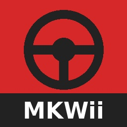

# Mario Kart Wii → Switch: native builder

One click that turns **your own** Mario Kart Wii (PAL, `RMCP01`) dump into a
*native* Switch `.nro` — statically recompiled guest code, not an emulator — and
hands you a zip whose contents sit at their real SD paths.

That badge is honest about its own scope: it runs the *tooling* on Linux and on
macOS (Apple Silicon) — the one-file builder unpacking itself, the engine's
NDJSON contract, the pinned render-stack package downloading and installing for
real. It does not build a `.nro`, because a CI has no game dump, and it does not
claim a full build on those platforms.

## How to use it

1. Get the builder:
   - **Releases page:** `MKWii-Builder.cmd` (Windows) or `MKWii-Builder.command`
     (macOS / Linux). Each is one self-unpacking file, no Python or git needed.
   - or run `Bouw-NRO.cmd` / `bouw-nro.command` from this repo.
2. Point it at your dump (`.rvz`, `.iso` or `.wbfs`) — drag and drop works.
3. Press build. It installs the devkitA64 toolchain, fetches the prebuilt render
   stack, extracts the game data with `nod`, compiles, and packages.
4. Unpack the resulting zip onto the SD root and start `MKWii` from hbmenu — the zip
   carries its own one-page `README.txt` about what "first boot takes a while" means.

Needs about 12 GiB free and a few minutes on a normal desktop. Put the folder on the
PC's own disk: a USB stick or an exFAT drive works too, but git refuses to work in a
folder whose drive does not record file ownership until it is trusted — the builder
trusts its own folder (and only that one) instead of stopping there. Docker is
optional — the builder can run devkitA64 natively.

The translation step needs a real Python 3. On Windows the names `python` and
`python3` often point at the Microsoft Store shortcut instead of an interpreter,
which fails only when the build is already running; the builder looks up an
interpreter that actually runs and links those two names to it for its own
processes, so a shortcut in the PATH is not a reason to install anything.

The dump is **not** in this repository and cannot be: you have to bring your own
copy of the game. The built `.nro` and the extracted game data are guest code, so
they are not shareable either — the tooling here is.

## This is not my code

Everything that actually ports the game is other people's work; this repository is
the glue around it:

- the Wii→Switch recompilation itself: **yashin-sh / WiiCompiled-Switch**, plus the
  Deko3D/GPU porting discussion around it
- **Dawn / Tint** (Google, BSD-3) cross-compiled for Switch, and **libuam**
  (**averne**, zlib-style) — the two libraries the product links against
- **nod** (**encounter**) for reading the disc, **aurora** for the Abseil patch the
  Switch build needs
- **devkitPro / devkitA64**, **CMake**, **Ninja**, **ccache** for the toolchain, and
  **DriftDroid**'s Dawn-on-console work, pinned as a reference commit in the receipt

Two facts that belong up here rather than buried: this builder pins DriftDroid's
`android-port` at `8b33d310` (2026-10-09) — that branch is 21 commits ahead as measured
on 2026-11-05, and the pin is deliberate because every other input is pinned too — and
the frame-dump stall described below was **fixed upstream by them** in `ce83b2cf`
(2026-11-03); our delta makes the same change for the older pin and turns it into a
build-time macro. What is not upstream is the writable cache VFS.
`README-Switch-Port.md` § *Relationship to upstream* gives the line numbers, the
reproduction steps, and our patch's honest port state against their HEAD (it does not
yet apply cleanly). The cache defect itself is reported upstream as
[dorPXP/driftdroid#29](https://github.com/dorPXP/driftdroid/issues/29); no PR is offered
here, because the branch belongs to them.

Licenses: the scripts, patches and CI glue in this repo are GPL-3.0-only, matching
the upstream port (`LICENSE`). The compiled render-stack package ships the licence
texts of Dawn, Abseil and libuam inside the archive; it contains no guest code.

`tools/render-deps.sh` turns that render stack — the step that used to cost hours of
cross-compiling — into a 76 MB hash-verified download, which is attached to the
release and pinned by name, size and sha256 in `tools/render-deps-pins.env`. That
package is built with Dawn's Switch bring-up diagnostics compiled out; see
`tools/build-quiet-dawn.sh` and the section on the five-second hitch in
`README-Switch-Port.md`.

## Where this stands

Verified on real hardware: a playable race (that build is `a58e4bdf…`). Two findings
since then, both confirmed on the console rather than inferred from the code:

- **The pipeline caches never opened at all.** SQLite on Horizon defaults to the
  `unix-none` VFS, which refuses every open, so `Cache/*.db` stayed absent and each
  boot recompiled all shaders. With the SDL-backed VFS registered as default, the
  caches are written and reused (measured: 368 KB + 561 KB after a warm boot). The
  black vehicle silhouettes belong to a genuinely cold first boot — the price of
  compiling every shader once — and are gone from the next start.
- **The recurring ~5 s stutter was an instrument, not the game.** Dawn's Deko3D
  backend dumps renderer state every 300th presented frame: it waits for the GPU,
  then walks about four million pixels on the CPU. Counting frames rather than
  seconds is why it also happened in menus and while paused. The shipped package
  compiles that flag out, so every frame count measured before this is contaminated
  and no FPS number is quoted here.

`README-Switch-Port.md` documents the pipeline, the provenance checks and the limits
in detail.
